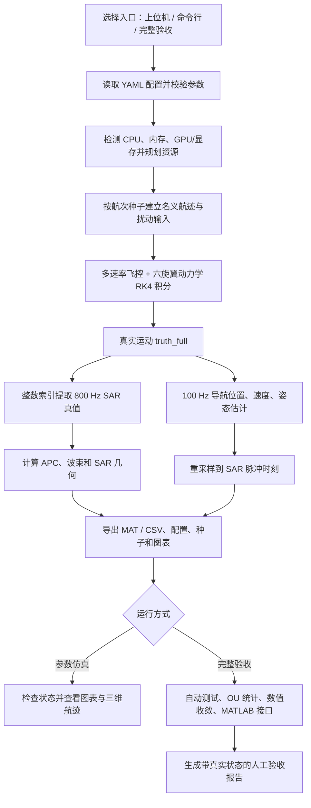

# UAV Motion Sim 工作流程

**OpenSource 版本说明：** 本目录默认调用 RotorPy 3.0.0 的多旋翼动力学 RHS；以下通用流程中“六旋翼动力学”的具体后端由 `runtime.backend` 选择。集成范围见 [开源集成状态](OPEN_SOURCE_INTEGRATION.md)。

本文描述当前代码实际执行的流程：从参数配置生成六旋翼真实运动，再生成导航估计和 SAR 运动接口，最后查看或验收结果。项目是**独立的运动仿真平台**；原有 L 波段 SAR 工程仍负责回波和成像。

## 一、整体流程

## 二、启动与配置

首次使用在项目根目录运行 `scripts/setup.ps1`，安装项目使用的 `uv` 环境。之后有三种入口：

| 入口 | 操作 | 适用场景 |
|---|---|---|
| 桌面上位机 | 双击 `main/open_control_panel.cmd` | 调整关键参数、看实时日志、导航位姿和可拖动三维航迹 |
| 命令行仿真 | `uv run --no-sync python -m uavsim.cli run --config configs/rotorpy_hex_x12.yaml --passes 2` | 批量或脚本化生成数据 |
| 完整人工验收 | 双击 `main/run.cmd`，或运行 `uv run --no-sync python main/internal/run.py` | 对双航次、统计、数值和 MATLAB 接口作完整本地检查 |

`configs/hex_x_12kg.yaml` 是无扰动基准；`configs/experiment_two_pass.yaml` 在它的基础上开启 A/B 运动扰动以及位置、速度、姿态导航估计误差；`configs/rotorpy_hex_x12.yaml` 再启用 RotorPy 后端。`main/config.yaml` 继承 RotorPy 双航次配置，供人工验收使用。YAML 的 `extends` 相对当前配置文件解析，最终由 Pydantic 校验。上位机在启动任务时保存独立的 `input_config.yaml`，运行中继续编辑界面不会改变该任务的参数。

默认独立平台基准为 SAR 采样率 **800 Hz**、APC 名义高度 **300 m**、沿航向速度 **10 m/s**、采集时长 **20.48 s**。采集时刻包含两端，点数按 `N = f × T + 1` 计算，其中 `f` 为采样率、`T` 为采集时长；因此每航次有 **16,385 个 SAR 脉冲时刻**，100 Hz 导航记录有 **2,049 点**。该式要求 `f × T` 为整数，本项目用配置校验保证各时间网格兼容。采集前另有 5 s 预稳定。实际数量随用户配置改变。

## 三、单航次如何生成

1. **资源与随机性。** 程序读取 CPU、可用 RAM、GPU 和显存信息，按内存预算与任务长度确定航次进程数，并限制每个进程的数值库线程。当前动力学计算使用 `float64` CPU；GPU 信息用于记录，**未启用 GPU 积分**。每航次使用独立种子，配置快照和资源决策随结果保存。
2. **名义航迹与扰动。** `trajectory` 生成 APC 和质心参考位置、速度、姿态；`disturbances` 在积分前生成各轴随机或常量扰动。A/B 可进入飞控指令层，也可按明确的 N、N·m 单位进入动力学层。指令层输入经过平滑；随机数不在积分方程求值时临时抽取。
3. **闭环真实运动。** 位置、速度、姿态和角速度控制环分别按配置频率更新。六旋翼分配得到受推力约束的电机指令，电机一阶动态与刚体方程共同构成 19 维状态，使用固定步长 RK4 积分。默认积分率为 3,200 Hz。此阶段产出 `truth_full`，包含预稳定和采集期间的真实状态。
4. **导航式输出。** 在独立的 100 Hz 时间轴上，从真实状态生成质心位置、速度、姿态角和四元数，并分别叠加可配置的位置、速度和姿态估计误差。姿态误差通过旋转矩阵右乘小旋转实现。导航误差**不反馈飞控，也不改写真值**。当前角速度和加速度仍以 `truth_` 真值字段输出，不代表传感器估计。
5. **SAR 对接状态。** 程序用整数步索引从真实动力学提取 800 Hz `truth_sar`，计算 APC 杆臂位置、速度、加速度和波束方向。100 Hz 导航位置、速度线性重采样到脉冲时刻，姿态使用 SLERP；不会在 800 Hz 再抽一遍导航噪声。几何解耦实验结果单独保存在 `sar_geometry`，不覆盖刚体真值。

内部导航系采用 X 前、Y 右、Z 下的 NED 型右手系，机体系为 FRD；对外 SAR 坐标为 X 前、Y 右、Z 上。`q_NB_wxyz` 表示机体系到导航系的四元数，标量在前。**质心与 APC 是两个不同位置**：默认 APC 高度为 300 m，天线杆臂会使质心高度不同。坐标和单位详见 [坐标说明](docs/coordinate_system.md)。

## 四、结果文件与查看方式

每次运行创建新的时间戳目录，不覆盖已有原始结果。命令行仿真通常写入 `results/run_<timestamp>/`；上位机写入 `main/gui_outputs/<mode>_<timestamp>/`，其计算数据位于 `artifacts/` 下；完整验收默认写入 `main/outputs/acceptance_<timestamp>/`。

| 主要产出 | 作用 |
|---|---|
| `navigation_pass1.csv`、`navigation_pass2.csv` | 100 Hz 导航估计位姿：位置、速度、姿态角、四元数、APC 等 |
| `navigation_truth_pass*.csv` | 同时刻真值，用于与导航估计对照 |
| `uav_motion_pass*.csv` | 800 Hz 脉冲同步运动状态 |
| `uav_motion_pass*.mat` | 完整真实状态、导航状态、参考航迹、扰动与 SAR 几何 |
| `config_snapshot.yaml`、`metadata.json`、`validation.json` | 本次参数、随机种子、版本、资源决策和运动检查 |
| `*.png` | 中文结果图；包括导航对照、APC 三维航迹、执行器与扰动 |

上位机“结果查看”可切换航次，在时间滑块上逐帧比较导航估计与真值；“三维航迹（可拖动）”可用鼠标旋转质心或 APC 航迹。默认各轴独立缩放，用于看清小幅横向和高度偏差；需要实际几何比例时勾选“真实比例”。也可以载入已有数据目录。字段、频率和 MAT 结构详见 [数据接口](docs/data_interface.md)。

## 五、仿真与验收的区别

上位机的“运行仿真”或命令行 `run` 会生成物理运动、导航记录、图表和基本状态检查，适合调参；**完成仿真不等于完成完整验收**。

“完整验收”固定运行双航次，随后检查自动化测试、20,000 s OU 长序列统计、1,600/3,200/6,400 Hz 数值收敛，并在可用时调用 MATLAB 检查导航、几何及原 SAR 工程的单点回波接口。结果目录含 `acceptance.json`、`run.log` 和可离线打开的 `index.html`；未执行的检查标记为未执行，失败项标记为失败，不会显示为全部通过。MATLAB 可设为 `auto`、`required` 或 `skip`；无 MATLAB 或跳过完整接口时，报告可能为部分完成。

人工验收建议按以下顺序查看：参数快照与种子 → 采样数量和状态检查 → 100 Hz 导航真值/估计 → 三维航迹和其他中文图表 → 数值收敛与 OU 统计 → MATLAB 接口记录。完整验收入口和目录结构详见 [人工验收说明](main/README.md)。

## 六、外部开源飞控验证

新增的 `main/tools/run_external_validation.cmd` 在独立 Ubuntu-24.04 WSL 中依次启动 ArduPilot SITL 与 XTDrone2/PX4/Gazebo/DDS，执行 Hex-X 解锁、起飞、降落和自动停桨，保存实际导航消息、组件日志及中文航迹图。本入口已串联运行通过。版本、控制适配补丁与完整证据见 [外部平台部署](deployment/README.md)。

外部导航来自实际飞控估计器，时间轴按原消息保留；不是默认 100 Hz 合成误差导航，也不将消息重采样后冒称为 800 Hz SAR 真值。当前完成的是短时起降验证，尚未完成与 RotorPy 相同 SAR 航线和所有物理参数逐项一致性对照。

## 七、适用边界

模型参数和导航误差标准差是可配置的工程初值，尚未经实机测量标定。主 RotorPy 链路的导航输出是合成误差模型，外部 ArduPilot/PX4 链路另有实际飞控估计器；原 SAR 回波仍使用固定波束权重，未消费随姿态变化的波束。Simscape 和实机交叉验证尚未完成。数值收敛结果不能直接解释为实机定位精度。
