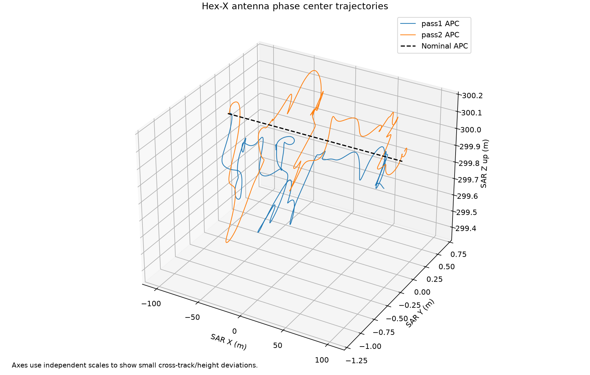
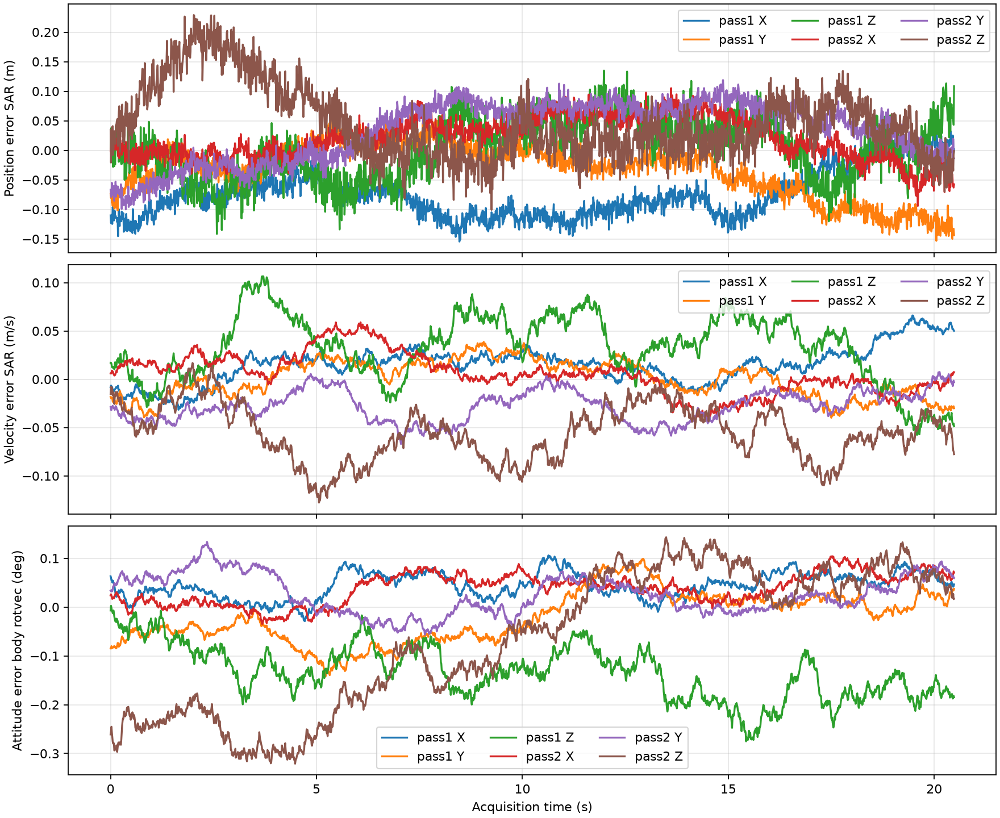
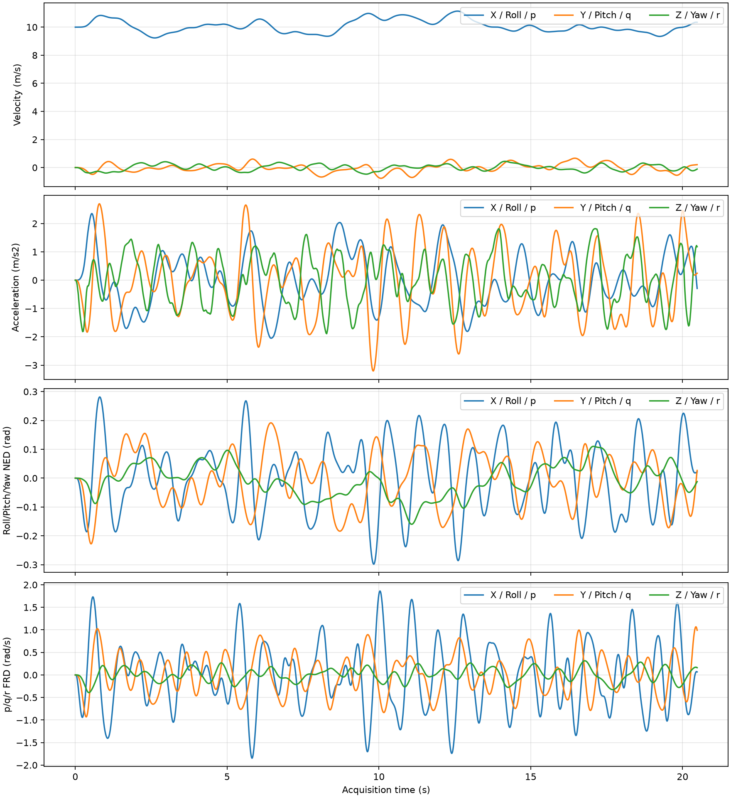
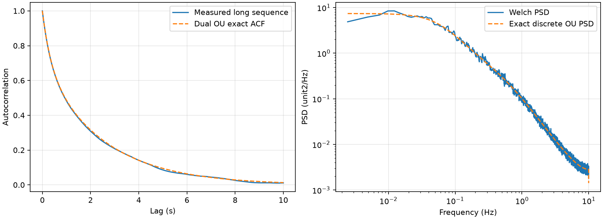
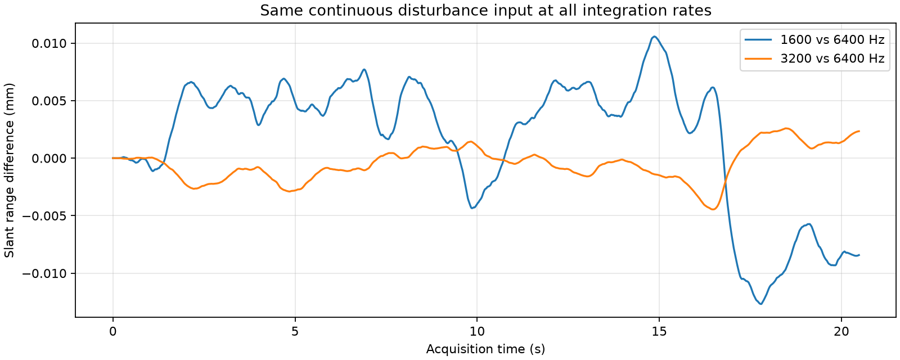

# 实际验证报告 — 2026-10-30

> 历史记录/原始设计：以下参数、测试数量、路径和结论仅对应文中版本，不是最终版现状。最终版统一以 [v1.0.0发布说明](FINAL_RELEASE.md) 和其引用的最终验收记录为准。原始结果未追溯修改。

独立平台与追加导航式位姿输出已完成本地数值和接口验证。本报告所有数字来自实际日志，不能解释为实机精度或外部飞控验证。

## 测试与版本

- Python 3.11.15；uv 独立环境；精确依赖见 `uv.lock` / `requirements.lock`。含本机绝对路径的原始环境快照已归档，不随公开源码发布。
- 最终自动化测试：**54 passed**，实际用时 33.10 s；[完整输出](validation_artifacts/pytest_output.txt)、[JUnit](validation_artifacts/pytest_results.xml)。
- Ruff：全部检查通过。
- 源文件 SHA256：`56d4b44c024f44afc256153bf5d2dd597eb38c2d86b70fa10163442af3e023de`；最终日志与当前数值源文件指纹已核对一致。
- 最终运行目录：`results/validate_20261030_120748_189636`；性能目录：`results/benchmark_20261030_121133_577435`。历史首次验证结果另存，未覆盖。

## 核心与导航式输出

实际生成两次共同名义航迹、独立种子的航过。种子 20260604 / 20260605；每航次完整刚体状态 81,537 点、采集动力学 65,537 点、SAR 16,385 点、导航位姿 2,049 点。

主要数据为 navigation_pass1/2.csv 和 navigation_pass1/2.mat，包含位置、速度、姿态角、四元数、估计 APC，并另存 navigation_truth。加速度与角速度目前标记为真值通道。位置、速度和姿态估计误差模型与真实动力学逐位隔离；100→800 Hz 采用位置/速度线性与姿态 SLERP。

用户已同意新增候选参数：速度慢变标准差 [0.02,0.02,0.04] m/s、相关时间 3 s；姿态旋转向量标准差 [0.05°,0.05°,0.10°]、相关时间 5 s。三类误差独立且全部可配置；尚未经过设备实测标定。

首航次真实四元数最大模误差 2.220e-16，导航四元数最大模误差 2.220e-16。
首航次 dp/dt-v RMS 9.007e-08 m/s，dv/dt-a RMS 1.061e-05 m/s²，旋转运动学残差 RMS 4.336e-07 1/s。未发现 NaN/Inf。

导航误差合成样本首航次分量 RMS：位置 0.065445 m、速度 0.032713 m/s、姿态旋转向量 0.001639 rad。这些是本次短孔径样本量，不用来重新标定预设标准差。

控制器验收覆盖悬停、巡航、速度偏差、高度恢复、加减速、升高、横移、Roll/Pitch/Yaw 恢复；各用例尾段速度误差 <0.1 m/s、高度误差 <0.05 m，无持续尾段振荡，并满足旋翼限制。分配器另做不可行大力矩的饱和测试。基础动力学还通过自由落体、电机指数解析解、恒力矩、无外力矩能量/惯性角动量守恒交叉验证。

## 随机与数值收敛

OU 统计使用 400,000 点、20,000 s 长序列：均值 0.000209、方差 0.993013、ACF 最大误差 0.009337、独立流相关系数 0.001550，PSD 积分方差 0.992900，全部满足预先指定门槛。

1600/3200/6400 Hz 使用完全相同的公共 6400 Hz 连续 OU 样条输入，显式激励为 FRD Y 外力标准差 2 N 和 Roll 力矩标准差 0.1 N m，采集全长 20.48 s。

| 指标 | 1600 vs 6400 Hz | 3200 vs 6400 Hz |
|---|---:|---:|
| 目标斜距差 RMS (m) | 5.92413161e-06 | 1.55488096e-06 |
| APC 分量差 RMS (m) | 5.43338426e-06 | 1.41932358e-06 |
| 姿态测地误差 RMS (rad) | 2.46243446e-06 | 6.92258573e-07 |
| 双程相位差 RMS (rad) | 0.000297985482 | 7.82109483e-05 |

3200 Hz 斜距差 RMS 约 **0.00155 mm**，低于 1 mm 门槛。相位换算波长 0.249827048333 m，只用于验证报告，不修改现有雷达参数。该结果是指定输入下的积分误差，不是实际导航定位精度。

## MATLAB 实测

MATLAB R2026a Update 2 实际读取两个航次完整数据和 100 Hz 独立导航文件。两航次 APC 重建最大差为 0 m、时间轴逐点精确一致；四元数、旋转正交性、导航误差/真值分离和重采样节点检查通过。

实际调用已有 L 波段 simulate_echo，生成 **4096×16385** 单点复回波，斜距最大核对误差 5.684e-14 m。[MATLAB 结果](validation_artifacts/matlab_validation.json)。

验证时曾发现 Python int64 频率在 MATLAB 中导致整数时间除法，已修正读取侧 double 转换；修复后严格时间检查通过，没有放宽阈值。

## 实际资源与性能

检测到 24 逻辑 CPU、物理内存 31.84 GiB，NVIDIA RTX 3060 Laptop GPU；显存报告以 nvidia-smi 读取结果为准。CIM 未返回物理核信息，记录为 unknown，并按逻辑 CPU 约束处理。

完整双航次单独性能实测：串行 21.287 s，并行 12.191 s，本次比值 **1.746**；位置、速度、姿态、角速度逐位一致。工作进程峰值 working set 为 241.9, 242.1 MiB。性能受机器负载影响，不承诺固定加速比。

当前采用 float64 CPU 航次并行，gpu_used=false；GPU/显存检测已实现，但没有把检测冒充已完成 GPU 加速。内存预算、线程数和进程上限记录于 [metadata](validation_artifacts/metadata.json) 与 [benchmark](validation_artifacts/benchmark.json)。

## 图表

## 验证边界与下一步

1. P0–P7 核心功能已按上述测试本地验证；新增导航姿态/速度误差按用户同意的可配置候选值实施。尚未完成 P8 ArduPilot SITL、Simscape 或实机交叉验证。
2. 当前机体与扰动参数未经实测辨识。导航输出是统计估计误差模型，不是 GNSS/IMU 融合滤波器；当前采用局部坐标，没有地理原点或绝对导航时间映射。
3. 原 SAR beam_weight 仍使用固定名义波束，不自动消费随姿态变化波束；回波接口验收覆盖完整位置航迹与斜距。可在后续明确授权修改原 SAR 工程后增加姿态波束照射权重。
4. GPU 动力学与大量 Monte Carlo 批处理后端尚未实现；本次已验证 CPU 并行、内存规划与结果一致性。
